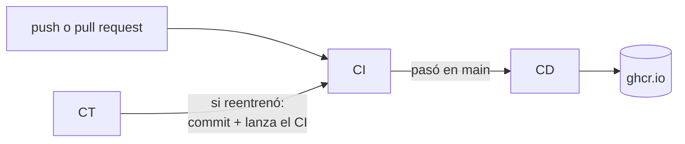

# Heladería: ejemplo de CI/CD/CT

Un modelo que predice cuántos helados se venden en el día según la temperatura, con un backend (FastAPI), un frontend (una página HTML) y los tres pipelines de MLOps en GitHub Actions:

- **CI**: verifica datos, modelo y código en cada cambio.
- **CD**: construye la imagen Docker, la prueba y la publica en `ghcr.io`.
- **CT**: con datos nuevos revisa si hay drift y, si el modelo dejó de servir, lo reentrena y lo despliega.

---

## Cómo levantarlo

### En tu computadora

Requisito: Python 3.12 (sirve de 3.10 a 3.13).

```bash
git clone https://github.com/kenjikv/heladeria-ci-cd-ct.git
cd heladeria-ci-cd-ct
python3 -m venv .venv
source .venv/bin/activate        # en Windows: .venv\Scripts\activate
pip install -r requirements.txt
uvicorn src.app:app --reload
```

Abrir <http://localhost:8000>, mover la temperatura y ver la predicción.

### Lo que hacen los pipelines, paso a paso a mano

Con el entorno activado y desde la carpeta del proyecto:

```bash
python src/validar_datos.py datos/ventas.csv                # verificar los datos
python src/entrenar.py datos/ventas.csv                     # entrenar (se guarda solo si MAE <= 15)
pytest -v                                                   # pruebas de datos, modelo y API
python src/simular_datos.py precio_alto datos/nuevos.csv    # llegan datos nuevos
python src/revisar_drift.py datos/nuevos.csv                # ¿hay data drift o concept drift?
```

### Con Docker

```bash
docker build -t heladeria .
docker run -p 8000:8000 heladeria
```

O directamente la imagen que publicó el CD:

```bash
docker run -p 8000:8000 ghcr.io/kenjikv/heladeria-ci-cd-ct:latest
```

### Lanzar el CT

En GitHub: pestaña **Actions → CT → Run workflow**, elegir el escenario y ejecutar. O desde la terminal:

```bash
gh workflow run ct.yml -f escenario=precio_alto
```

Si el CT reentrena, al terminar el CD hay una imagen nueva: `docker pull ghcr.io/kenjikv/heladeria-ci-cd-ct:latest` y la página muestra el modelo nuevo y su fecha de entrenamiento.

> En un fork: activar los workflows en la pestaña **Actions**. La imagen queda en `ghcr.io/<tu-usuario>/heladeria-ci-cd-ct`.

---

## Cómo está hecho

### Estructura

```
heladeria-ci-cd-ct/
├── datos/ventas.csv            # datos con los que se entrenó el modelo actual
├── modelo/modelo.json          # el modelo: pendiente, intercepto, error y fecha
├── src/
│   ├── simular_datos.py        # simula los datos nuevos de cada semana (escenarios)
│   ├── validar_datos.py        # verifica columnas, vacíos, rangos y ventas negativas
│   ├── entrenar.py             # entrena una regresión lineal con puerta de calidad (MAE <= 15)
│   ├── revisar_drift.py        # data drift (prueba KS) y concept drift (error > 15)
│   └── app.py                  # backend FastAPI: /, /api/predecir, /api/modelo
├── frontend/index.html         # la página: control de temperatura y predicción
├── tests/                      # pruebas con pytest
├── Dockerfile                  # imagen solo con la API (sin scikit-learn)
├── requirements.txt            # todo (desarrollo, entrenamiento y pruebas)
├── requirements-api.txt        # solo lo que necesita la API
└── .github/workflows/
    ├── ci.yml
    ├── cd.yml
    └── ct.yml
```

### El flujo



| Pipeline | Cuándo corre | Qué hace |
|---|---|---|
| **CI** (`ci.yml`) | En cada push a `main`, en cada pull request y cuando lo lanza el CT | 1. Verifica `datos/ventas.csv` · 2. Corre las pruebas: validación de datos, entrenamiento, el modelo guardado pasa la puerta de calidad, detección de drift y la API |
| **CD** (`cd.yml`) | Cuando el CI termina bien en `main` | 1. Construye la imagen Docker del commit que pasó el CI · 2. La levanta y le pide una predicción · 3. Si responde, la publica en `ghcr.io` con dos etiquetas: el SHA del commit y `latest` |
| **CT** (`ct.yml`) | Cada lunes 12:00 UTC o a mano | 1. Llegan datos nuevos (simulados) · 2. Los verifica · 3. Revisa drift · 4. Si hay concept drift, reentrena con los datos nuevos · 5. Guarda datos y modelo con un commit y lanza el CI (que a su vez lanza el CD) |

### Escenarios del CT

| Escenario | Qué pasa en la heladería | Resultado del CT |
|---|---|---|
| `normal` | Primavera, ~20 °C, precio normal | No hay drift: no hace nada |
| `verano` | ~30 °C, misma regla de ventas | Data drift pero el error sigue bajo: no reentrena (se vigila) |
| `precio_alto` | ~30 °C, pero con el mismo calor se venden menos helados | Concept drift (error ~77): reentrena, guarda y despliega |
| `datos_malos` | Celdas vacías y ventas negativas | Falla la verificación de datos: se detiene sin tocar nada |

Para repetir la demostración, alternar `precio_alto` y `normal`: cada cambio de regla vuelve a provocar concept drift.

### Decisiones

- **El modelo es un JSON** (pendiente e intercepto). El commit del CT muestra en el diff cómo cambió la recta, y la imagen Docker no necesita scikit-learn. Con un modelo más grande se guardaría con `joblib` o en un registro de modelos.
- **Una sola puerta de calidad: MAE ≤ 15 helados por día.** `entrenar.py` no guarda un modelo peor que eso y `revisar_drift.py` pide reentrenar cuando el modelo actual se equivoca más que eso con los datos nuevos.
- **Se reentrena con los datos nuevos** (la última semana), porque los viejos responden a una regla que ya no existe.
- **Sin secretos.** El CD publica con el `GITHUB_TOKEN` del propio workflow (`permissions: packages: write`).
- **El CT lanza el CI a mano** (`gh workflow run`) porque un push hecho con el `GITHUB_TOKEN` no dispara otros workflows.
- **La imagen se prueba antes de publicarse**: si la API no responde, no llega a `ghcr.io`.
